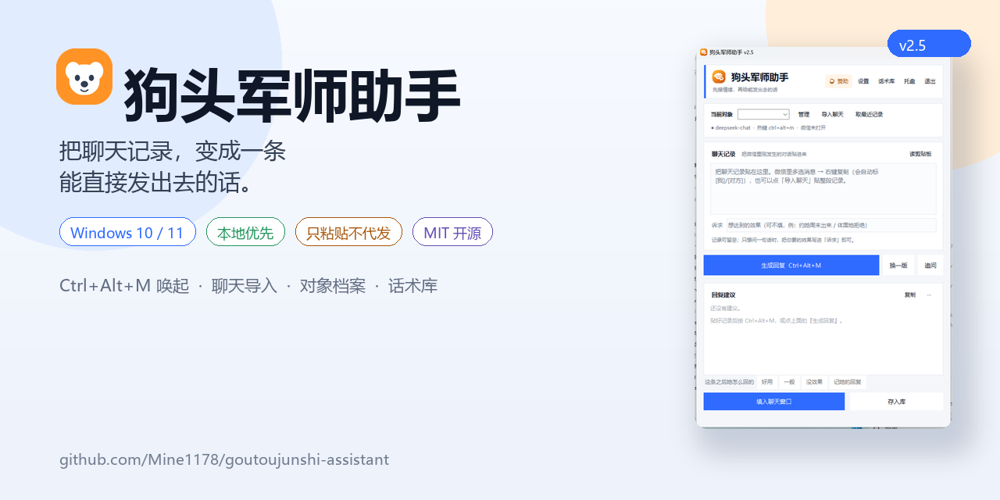
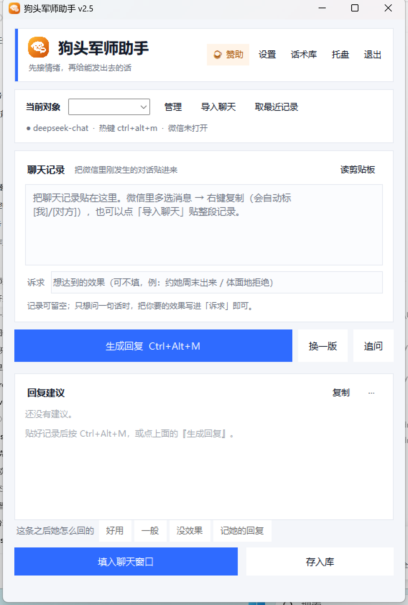

<div align="center">

# 🐶 狗头军师助手

**把聊天记录，变成一条能直接发出去的话。**

Windows 常驻 · 本地优先 · 只粘贴不代发 · MIT 开源

[](https://github.com/Mine1178/goutoujunshi-assistant/releases/latest)
[](LICENSE)
[](https://github.com/Mine1178/goutoujunshi-assistant/releases/latest)
[](https://www.python.org/)
[](https://github.com/Mine1178/goutoujunshi-assistant/stargazers)

[**⬇️ 下载 Windows 安装版**](https://github.com/Mine1178/goutoujunshi-assistant/releases/latest/download/GoutouJunshi_Setup_v2.5.exe) · [快速开始](#-30-秒上手) · [功能亮点](#-功能亮点) · [隐私边界](#-隐私与边界)

</div>



## ⬇️ 下载安装

| 版本 | 文件 | 说明 |
| --- | --- | --- |
| **v2.5 安装版** | [`GoutouJunshi_Setup_v2.5.exe`](https://github.com/Mine1178/goutoujunshi-assistant/releases/latest/download/GoutouJunshi_Setup_v2.5.exe) | Windows 10/11，双击安装，无需管理员权限 |
| 源码运行 | `git clone` 后 `启动.bat` | 适合开发、二次修改、自己打包 |

安装包 SHA256：

```text
6493F4AE91736A04DC54AA51D0C1918AC70F3F5F2F41AF18D83FC4B80C7356D0
```

> 公开版安装包不包含聊天数据，也不包含任何赞赏二维码。安装后数据只写入本机 `data/`。

## ✨ 它解决什么问题

微信里聊到一半，知道该回、但不想回错；想体面拒绝、想推进关系、想接住情绪，却卡在第一句话。

狗头军师助手把这件事拆成三步：

1. **把聊天记录给它**：粘贴、导入 txt，或直接从剪贴板读取。
2. **选对象、写诉求**：按人建档，记住关系背景、说话风格和上次效果。
3. **拿到能直接发的话**：自动复制；点「填入聊天窗口」粘进微信输入框，确认后自己按 Enter。

## 🎯 功能亮点

| | |
| --- | --- |
| **⌨️ 热键唤起** | `Ctrl+Alt+M` 随时叫出窗口；剪贴板里是聊天时直接生成 |
| **💬 聊天导入** | 粘贴 / txt / log / 文件夹增量同步；自动区分「我」和「对方」 |
| **🧠 对象档案** | 关系、背景、关键事件、说话风格、回复效果，一人一份 |
| **📚 话术库** | 好用的话存下来，按对象检索、复制、删除 |
| **📋 填入聊天窗口** | 找微信输入框并粘贴；**只粘贴、不回车、不自动发送** |
| **🪟 托盘常驻** | 关闭窗口不退出，托盘随时唤回 |
| **🔠 全局字号** | 8 档滑杆，标题、按钮、正文一起缩放，顶栏按钮同步联动 |
| **🔒 本地优先** | 配置、档案、记录都留在本机 `data/`，不上传本项目仓库 |

### 主界面预览



## 🚀 30 秒上手

1. **下载安装**：[`GoutouJunshi_Setup_v2.5.exe`](https://github.com/Mine1178/goutoujunshi-assistant/releases/latest/download/GoutouJunshi_Setup_v2.5.exe)
2. **打开设置**：填入任意 OpenAI 兼容接口的 `Base URL`、`API Key`、模型名（默认 DeepSeek）。
3. **填写昵称**：填你的微信昵称，程序才知道记录里哪句是你说的。
4. **开始使用**：微信里选中消息复制 → 按 `Ctrl+Alt+M` → 生成 → 点「填入聊天窗口」→ 自己确认发送。

没有 API Key 也能用：点回复区 `⋯` 里的「复制给豆包（完整提示词）」，把技能内核、对象档案和聊天记录拼成一条提示词，拿去其他模型生成。

## 🧩 从源码运行

环境要求：Windows 10/11、Python 3.10+（安装时勾选 tcl/tk）。

```powershell
git clone https://github.com/Mine1178/goutoujunshi-assistant.git
cd goutoujunshi-assistant
python -m pip install -r requirements.txt
python tools\bootstrap.py
python main.py
```

或者直接双击 **`启动.bat`**：自动寻找可用 Python、补装依赖、拉取技能、生成图标，然后启动。

## 📦 自己打包

```powershell
python -m pip install pyinstaller
powershell -ExecutionPolicy Bypass -File .\打包.ps1
```

需要安装 [Inno Setup 6](https://jrsoftware.org/isinfo.php)。产物：

- `dist/GoutouJunshi/GoutouJunshi.exe`：目录版
- `dist/GoutouJunshi_Setup_v2.5.exe`：安装包

## 🔒 隐私与边界

- **不读取**微信加密数据库，**不 hook** 微信进程，**不自动发送**消息。
- 只处理你主动复制到剪贴板的文本，或你指定目录里的 txt/log/md。
- 只有点击「生成回复 / 追问 / 换一版」时，才会把当前拼好的上下文发送到你配置的模型接口。
- 「填入聊天窗口」只执行 `Ctrl+A → Ctrl+V`，发送动作永远由你自己完成。
- `data/`、`chat/`、构建产物、赞赏二维码都已写进 `.gitignore`，不会被误提交。

## 🧠 技能来源

本地运行依赖上游技能目录 `skill/goutoujunshi`。为尊重第三方仓库，本仓库**不复制技能正文**，由 `tools/bootstrap.py` 首次运行时拉取：

- 上游：<https://github.com/shengjidaguai-china/goutoujunshi>
- 许可证：MIT（Copyright © 2026 powerycy）

安装版已内置该技能，装完即可使用。

## 🛠️ 技术栈

`Python 3.10+` · `tkinter` · `PyInstaller` · `Inno Setup` · OpenAI-compatible API

## 🤝 参与贡献

欢迎 Issue、Pull Request 和 Star。提交前请确认：

- 不包含真实聊天记录、联系人或个人信息；
- 不包含 API Key、Token、Cookie 等凭据；
- 新增依赖时同步更新 `requirements.txt`；
- Python 代码通过 `python -m py_compile`。

## 📄 License

本项目代码采用 **MIT License**，见 [LICENSE](LICENSE)。第三方技能按上游 MIT License 使用，版权归原作者所有。

<div align="center">

**如果这个工具帮你少打几个字，点个 Star ⭐ 就是最大的支持。**

</div>
